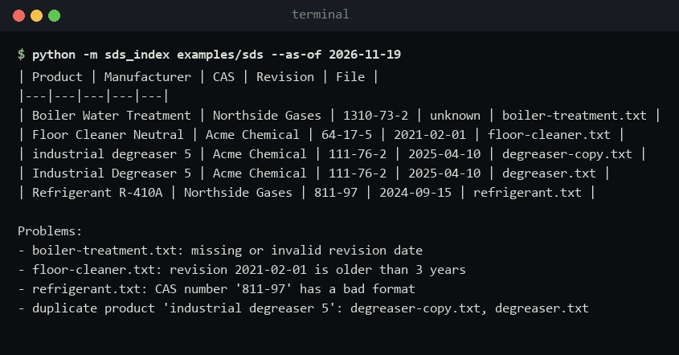

<p align="center"></p>

# safety-data-sheet-index

A command-line tool that scans a folder of safety data sheet (SDS) text files, builds a Markdown index by product, and lists the problems it finds.



## What it is for

A mechanical room or janitorial closet usually holds a binder of safety data sheets (SDS, the manufacturer documents that describe a chemical's hazards) that nobody has checked in years. Safety officers, facility managers and maintenance supervisors need to know which sheets are missing a revision date, which are out of date, and which products are listed twice. This tool scans the folder, builds the index, and lists those problems, with exit code 1 when any exist so a script can act on it. The age limit defaults to 3 years.

## Install

```
git clone <repo-url> safety-data-sheet-index
cd safety-data-sheet-index
python -m pip install -e .
```

Run the tests with `python -m pip install pytest` then `python -m pytest -q`.

## How to use

The folder is searched recursively for .txt files. Exit code is 1 when problems exist and 0 when none.

| I want to | Command |
|---|---|
| Index a folder and list problems, using today's date | `python -m sds_index examples/sds` |
| Check as of a fixed date, so the result repeats | `python -m sds_index examples/sds --as-of 2026-11-19` |
| Change the age limit for a sheet to count as stale (default 3 years) | `python -m sds_index examples/sds --as-of 2026-11-19 --max-age-years 6` |

Worked example:

```
python -m sds_index examples/sds --as-of 2026-11-19
```

Output:

```
| Product | Manufacturer | CAS | Revision | File |
|---|---|---|---|---|
| Boiler Water Treatment | Northside Gases | 1310-73-2 | unknown | boiler-treatment.txt |
| Floor Cleaner Neutral | Acme Chemical | 64-17-5 | 2021-02-01 | floor-cleaner.txt |
| industrial degreaser 5 | Acme Chemical | 111-76-2 | 2025-04-10 | degreaser-copy.txt |
| Industrial Degreaser 5 | Acme Chemical | 111-76-2 | 2025-04-10 | degreaser.txt |
| Refrigerant R-410A | Northside Gases | 811-97 | 2024-09-15 | refrigerant.txt |

Problems:
- boiler-treatment.txt: missing or invalid revision date
- floor-cleaner.txt: revision 2021-02-01 is older than 3 years
- refrigerant.txt: CAS number '811-97' has a bad format
- duplicate product 'industrial degreaser 5': degreaser-copy.txt, degreaser.txt
```

## How it works

- Every .txt file under the folder is read line by line for Product name:, Manufacturer:, CAS Number: and Revision date: (case-insensitive, first value wins).
- Revision must be ISO format; anything else counts as missing.
- A sheet is stale when its revision is more than max-age-years times 365 days before the as-of date.
- A CAS number must match the pattern of 2 to 7 digits, 2 digits, 1 check digit. The check digit itself is not verified.
- Duplicates are products with the same name ignoring case.

## Limits

It reads plain text only, not PDF. It expects the four field labels above. The 3 year age limit is a house rule you can change with --max-age-years, not a legal requirement.

## License

MIT. Copyright 2026 Yassine Emhamed.
